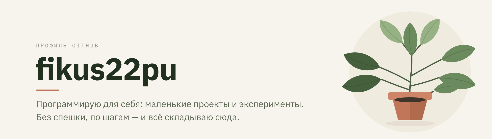

  

Привет. Это профиль **fikus22pu** — здесь я учусь программировать для себя:
собираю небольшие проекты и складываю сюда то, что получилось.

### Чем занят

- Изучаю основы программирования — по шагам и без спешки.
- Делаю маленькие проекты, чтобы закрепить практику.
- Пока без конкретного стека: выбираю, что зайдёт.

### Репозитории

Публичных проектов пока нет. Первые появятся здесь, как только будет что показать.

### Идеи и обратная связь

Если есть совет или идея — напишите в [Issues](https://github.com/fikus22pu/fikus22pu/issues). Я читаю всё.
